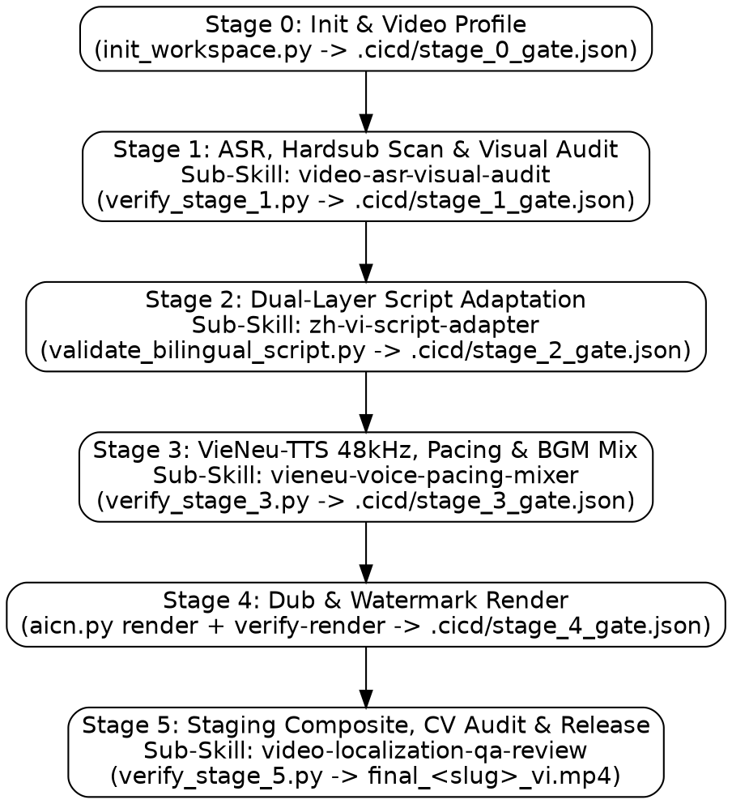

# Video Localization Orchestrator & CI/CD Gatekeeper

## Overview

Master supervisor and CI/CD gatekeeper for end-to-end video localization into Vietnamese. Coordinates 5 specialized sub-skills through a **cryptographically enforced 6-stage CI/CD pipeline (`Stage 0` to `Stage 5`)** where every stage must pass a deterministic Python validator (`100/100` score) and write a SHA-256 signed gate token (`workspace/<slug>/.cicd/stage_N_gate.json`) before the next stage's scripts will execute.

**Violating the letter of the rules is violating the spirit of the rules. No stage can produce output unless its upstream CI/CD gate token is verified.**

---

## Internal Sub-Skills Catalog (9 Core Capabilities)

This orchestrator skill bundles **9 distinct operational sub-skills** that govern project setup, genre adaptation, channel branding, state locking, and failure recovery:

### Sub-Skill 1.1: Multi-Format Video Profiling & VFR Detection
Probes source media via `ffprobe` to classify aspect ratio (`landscape_16x9` vs. `vertical_9x16`), frame rate stability (`r_frame_rate` vs. `avg_frame_rate` for VFR drift risk), audio sample rate/channels, and default hardsub scan coordinates (`strip_y0`, `strip_h`), saving `data/00_video_profile.json`.

### Sub-Skill 1.2: Dual Localization Mode (`voice_dub` vs. `sub_only`) & Genre Calibration
Selects the optimal localization architecture (`--mode voice_dub | sub_only | auto`) and subtitle visual style (`--overlay-style frosted_glass | solid_pill`) based on content genre (`tech-review`, `short-drama`, `documentary`, `tutorial`):
- **`voice_dub` Mode (Default for `tech-review`, `documentary`, `tutorial`):** Synthesizes 48kHz Vietnamese narration with `VieNeu-TTS`, hard-locks `slot_start`, and mixes with auto-ducked `no_vocals.wav`.
- **`sub_only` Mode (Default for `short-drama` & multi-character cinematic films):** Preserves 100% of the original native acting, emotional cries, telephone filters, and spatial sound effects (`master_audio_48k.wav` extracted losslessly at 48kHz stereo from source) while rendering complete Vietnamese subtitles covering 100% of normal speech, phone calls, radio comms, PA broadcasts, and whispers.
- **`frosted_glass` vs. `solid_pill` Overlay Style:** Defaults to `frosted_glass` (compact capsule with specular hardsub stroke suppression + Gaussian frosted blur `radius=14` + translucent dark glass `rgba(12,15,22,148)` + `1px` specular border) so the subtitle panel never looks bulky or crude over cinematic scenes. See [genre_playbooks.md](./references/genre_playbooks.md) for the complete parameter matrix.

### Sub-Skill 1.3: Multi-Topology Workspace Initialization, Storage Architecture & Templates (`init_workspace.py`)
Enforces a zero-entropy v2.0 storage architecture across **3 project topologies** (`--topology single | series_compilation | series_episodic`). Never scatter files in `/tmp` or the project root, and never put `.json` or `.srt` data files inside `scripts/`.
- **`single` Topology:** 1 standalone video ingested into `source/master_source.mp4` (`source/episodes/ep01.mp4`), producing `deliverables/16x9/`, `deliverables/9x16/`, and `deliverables/subtitles/`.
- **`series_compilation` Topology:** Ingests multiple short episodes (`--episodes-dir` or `--episodes`) into `source/episodes/ep01..epNN.mp4`, verifies stream compatibility, concatenates into `source/master_source.mp4`, writes `data/00_episodes_manifest.json` with exact cumulative timeline boundaries (`timeline_start_s`, `timeline_end_s`, `timecode_range`), tags every segment with `ep_id`, and supports post-render splitting back into individual episodes (`deliverables/episodes/epXX_*`) via `split_compiled_episodes.py`.
- **`series_episodic` Topology (Series Hub):** For long multi-episode series (20–100+ episodes), provisions a parent Series Hub (`workspace/<series-slug>/`) holding the shared `config/series_bible.json` (Character Roster, Pronoun Matrix `xưng hô`, Voice IDs, and World Glossary), `source_inbox/`, `units/<unit-slug>/`, and consolidated `deliverables/`.
- **Auto-Generated Config & Schema Templates:** `init_workspace.py` writes `config/project_config.json` (exact path map for every file), `config/series_bible.json`, `config/schemas/01..03.template.json`, and genre/mode-matched Markdown logs (`00..04.md`). See [workspace_and_storage_architecture.md](./references/workspace_and_storage_architecture.md) for the complete storage contract.

### Sub-Skill 1.4: Cryptographic CI/CD Gate Enforcement (`cicd_gate.py`)
Replaces subjective agent "self-grading" with deterministic Python gate validators (`verify_stage_1.py` .. `verify_stage_5.py`).
- Each validator evaluates weighted programmatic checks, hashes all verified artifacts with SHA-256, signs `.cicd/stage_N_gate.json`, and exits with code `2` (`[CI/CD GATE BLOCKED]`) if score `< 100.0`.
- Every downstream script calls `require_gate(workspace, N-1)` on startup: if the upstream gate is missing, failed, or any input file was modified after signing, the downstream script refuses to run.

### Sub-Skill 1.5: Staging-First Output Locking (No Verification = No Output)
The final composite script (`Stage 5`) never writes directly to `media/final_<slug>_vi.mp4`. It writes to a locked staging file `media/.staging_final.mp4` and extracts stratified QA keyframes. Only when `verify_stage_5.py` confirms `100/100` across stream checks, automated computer-vision edge-leakage scans, and verified frame-by-frame audit logs in `04_qa_review_report.md` does it promote `.staging_final.mp4` to `media/final_<slug>_vi.mp4`.

### Sub-Skill 1.6: Surgical Rollback & Partial Re-Run Protocol
When a defect is caught at any gate (e.g., 5 segments exceed the `1.24x` tempo cap in Stage 3, or 1 frame leaks a Chinese character in Stage 4), execute surgical re-runs on only the affected segments rather than wiping the workspace.

### Sub-Skill 1.7: Long-Running Job Heartbeat & Telemetry Enforcement
Any process running longer than 30 seconds (`htdemucs`, `faster-whisper`, `VieNeu-TTS` batch synthesis, ProRes overlay generation, `ffmpeg` H.264 compositing) MUST print flushed progress (`flush=True`) every 10–15 seconds showing item count, percentage, speed, and elapsed time.

### Sub-Skill 1.8: Subagent Supervision & Anti-Laziness Audit
When delegating stages to subagents, never trust a subagent's verbal claim ("I checked all frames and translated everything"). Verify completion exclusively by running `cicd_gate.py --workspace workspace/<slug> --require-stage N`.

### Sub-Skill 1.9: Channel Branding, 2x2 Logo Pack Extraction & 16:9 Dual-Corner Watermark (`apply_channel_branding.py`)
Standardizes channel visual identity, logo asset extraction, and widescreen `16:9` (`1920x1080`) in-frame branding across all releases (see [channel_branding_and_watermark_guide.md](./references/channel_branding_and_watermark_guide.md)):
- **`16:9` Canonical Release Format (`export_formats: ["16x9"]`):** Always deliver widescreen `16:9` (`1920x1080`, `SAR 1:1`, `DAR 16:9`) as the standard release format (`deliverables/16x9/final_<slug>_vi.mp4`). Do not generate `9:16` crops unless explicitly requested.
- **`2x2` Master Brand Grid Slicing & Zero-Halo RGBA Extraction:** Generates a `2x2` brand sheet on Nano Banana 2.1 (`Q1: Pure Mascot Icon`, `Q2: Stacked Logo + 3D Wordmark`, `Q3: Traditional Red Seal 印章`, `Q4: Circular Avatar Emblem`) and slices it via border-seeded connected-component flood-fill + counter-hole knockout (`Đ, Ậ, Ỏ`) + `1px` erosion + `3x3` minimum-filter RGB edge color decontamination into `workspace/branding-<channel>/01..06_transparent.png` and `99_dark_bg_verification_sheet.png`.
- **In-Frame Dual-Corner Header Architecture (`1920x1080`, Safe Margin `42px`, Centerline `y = 93px`):**
  - **Top-Left Corner (`x = 42, y = 22`):** Large Horizontal Brand Lockup (`13_top_left_logo_large.png`, `height = 114px`, `opacity = 0.95` + soft drop shadow).
  - **Top-Right Corner (`x = W - w - 42, y = 58`):** Attribution text overlay (`"Vietsub by <Channel>"` + Red Seal) supporting 3 styles: **`floating`** (Default Style B: clean floating `"Vietsub by Đậu Đỏ"` in ivory/gold with crimson stroke + `38x38` red seal `15_top_right_vietsub_floating.png`), **`pill`** (Style A: dark translucent frosted capsule with gold border `14_top_right_vietsub_pill.png`), and **`3d_wordmark`** (Style C: seal + italic prefix + miniature 3D logo wordmark `18_top_right_vietsub_3d_wordmark.png`).

---

## Master Pipeline Architecture & Required Sub-Skills

Execute these stages in strict sequential order:



1. **Stage 0 (Init & Profile):** Run `init_workspace.py` in this skill.
2. **Stage 1 (ASR & Visual Audit):** **REQUIRED SUB-SKILL:** Use `video-asr-visual-audit`
3. **Stage 2 (Script & Dual-Layer Adaptation):** **REQUIRED SUB-SKILL:** Use `zh-vi-script-adapter`
4. **Stage 3 (Voice Synthesis, Pacing & BGM Mix):** **REQUIRED SUB-SKILL:** Use `vieneu-voice-pacing-mixer`
5. **Stage 4 (Dub & Watermark Render):** `aicn.py render` + `aicn.py verify-render` (no burned-in subtitle overlay).
6. **Stage 5 (Final Composite & Visual/Audio QA):** **REQUIRED SUB-SKILL:** Use `video-localization-qa-review`

---

## Standardized Workspace Directory Contract (`workspace/<slug>/`)

See [workspace_and_storage_architecture.md](./references/workspace_and_storage_architecture.md) for the full 3-topology specification (`single`, `series_compilation`, `series_episodic` Series Hub) and JSON schema templates.

```text
workspace/<slug>/
├── .cicd/                                 # Cryptographic CI/CD gate tokens (SHA-256 signed)
│   ├── stage_0_gate.json                  # Topology, source episodes, config & schema templates gate
│   ├── stage_1_gate.json                  # Audio stem, 5fps bbox scan, waveform onset & visual audit gate
│   ├── stage_2_gate.json                  # CJK=0, onset lock, reading speed, raw_id coverage & IPA gate
│   ├── stage_3_gate.json                  # 48kHz audio master, tempo<=1.24x, pause & zero-drift gate
│   ├── stage_4_gate.json                  # In-memory pixel-leakage=0, <=2 balanced lines & alpha MOV gate
│   └── stage_5_gate.json                  # ffprobe stream check, CV frame scan & deliverables release gate
├── config/                                # Project Config, Shared Series Bible & JSON Schema Templates
│   ├── project_config.json                # Canonical topology, mode, style, export_formats & exact file paths
│   ├── series_bible.json                  # Character Roster, Pronoun Matrix (xưng hô), Voice IDs & Glossary
│   └── schemas/                           # Read-only JSON item templates (01..03.template.json)
├── source/                                # Immutable Raw Input Videos & Concatenation Manifests
│   ├── episodes/                          # Raw episodes (ep01.mp4, ep02.mp4, ...)
│   ├── concat_list.txt                    # FFmpeg concat demuxer manifest
│   └── master_source.mp4                  # Canonical input video read by Stages 1–5
├── data/                                  # Single Source of Truth Pipeline State & Canonical SRT
│   ├── 00_video_profile.json              # Auto-detected resolution, FPS, VFR flag, strip_y0, strip_h
│   ├── 00_episodes_manifest.json          # Episode boundary map (ep_id, start_s, end_s, timecode_range, sha256)
│   ├── 01_asr_raw_segments.json           # Onset-clamped, blank-gap-split fine-grained clauses (with ep_id)
│   ├── 01_zh_bbox_scan.json               # 5fps stroke-validated hardsub bounding boxes + glyph IoU changes
│   ├── 01_waveform_voice_audit.json       # Acoustic waveform & visual sub-clause coverage report
│   ├── 01_extracted_audit_manifest.json   # List & SHA-256 hashes of keyframes extracted for Stage 1 audit
│   ├── 02_bilingual_script.json           # Dual-layer script (id, ep_id, speaker, raw_ids, start, end, zh_text, sub_text, tts_text)
│   ├── 03_aligned_subtitles.json          # Final locked timing & tempo per segment
│   ├── 04_qa_frames_manifest.json         # Stratified QA frames + SHA-256 hashes
│   └── subtitles_full.srt                 # Canonical exported SRT subtitle file
├── frames/
│   ├── audit/                             # Keyframes extracted in Stage 1 to inspect visual context
│   ├── qa/                                # Stratified 16:9 verification frames extracted in Stage 5
│   └── qa_9x16/                           # Stratified 9:16 vertical verification frames
├── media/
│   ├── source_audio.wav                   # 16kHz mono PCM for acoustic waveform & high-recall Whisper pass
│   ├── demucs/                            # vocals.wav & no_vocals.wav from htdemucs
│   ├── tts_segments/                      # seg_0000.wav .. seg_NNNN.wav (48kHz VieNeu-TTS)
│   ├── master_audio_48k.wav               # 48kHz stereo master audio track (TTS+BGM or native stereo)
│   ├── .staging_final.mp4                 # Locked staging encode prior to Stage 5 QA gate approval
│   ├── final_<slug>_vi.mp4                # Verified 16:9 master MP4
│   └── final_<slug>_vi_9x16.mp4           # Verified 9:16 vertical master MP4
├── deliverables/                          # Clean User-Facing Final Release Vault
│   ├── 16x9/final_<slug>_vi.mp4           # Ready-to-publish Landscape 16:9 MP4
│   ├── 9x16/final_<slug>_vi_9x16.mp4      # Ready-to-publish Vertical 9:16 MP4 (TikTok / Reels / Shorts)
│   ├── subtitles/<slug>_vi.srt            # Ready-to-publish Vietnamese SRT file
│   └── episodes/                          # Individual localized episodes (auto-split via split_compiled_episodes.py)
├── scripts/                               # Project-specific custom .py/.sh scripts ONLY (0 .json/.srt allowed!)
├── 00_project_manifest.md                 # Project topology, episode timeline map, specs & pipeline checklist
├── 01_visual_audit_notes.md               # Frame-by-frame visual OCR & acoustic phone/whisper audit log
├── 02_glossary_and_pronunciation.md       # Character pronoun matrix (xưng hô) + domain glossary + IPA rules
├── 03_pacing_and_audio_report.md          # Audio fidelity & pacing statistics
└── 04_qa_review_report.md                 # ffprobe verification + visual inspection table for 12+ QA frames
```

---

## Commands Reference

### 1A. Initialize a Single Video Workspace (`--topology single`)
Always execute using `$AICN_PY` (macOS `/Users/Shared/Tools/VieNeu-TTS/.venv/bin/python`, Windows `C:\Work\Tools\VieNeu-TTS\.venv\Scripts\python.exe`):

```bash
$AICN_PY .agents/skills/video-localization-orchestrator/scripts/init_workspace.py \
  --topology single \
  --video "bilibili/input.mp4" \
  --slug "bilibili-anthropic-distill" \
  --genre "tech-review" \
  --mode "voice_dub" \
  --overlay-style "solid_pill" \
  --export-formats "16x9" \
  --workspace-root "workspace"
```

### 1B. Initialize a Multi-Episode Compilation (`--topology series_compilation`)
Automatically ingests all episodes in `--episodes-dir` into `source/episodes/`, concatenates into `source/master_source.mp4`, and writes `data/00_episodes_manifest.json`:

```bash
$AICN_PY .agents/skills/video-localization-orchestrator/scripts/init_workspace.py \
  --topology series_compilation \
  --episodes-dir "downloads/quy_khu_s01" \
  --slug "drama-quy-khu-s01" \
  --genre "short-drama" \
  --mode "sub_only" \
  --overlay-style "frosted_glass" \
  --export-formats "16x9,9x16" \
  --workspace-root "workspace"
```

### 1C. Initialize a Multi-Episode Series Hub + Working Unit (`--topology series_episodic`)
Creates/updates `workspace/<series-slug>/` (holding the shared `config/series_bible.json` and `deliverables/`) and initializes a working unit at `workspace/<series-slug>/units/<unit-slug>/`:

```bash
$AICN_PY .agents/skills/video-localization-orchestrator/scripts/init_workspace.py \
  --topology series_episodic \
  --series-slug "drama-quy-khu" \
  --unit-slug "s01-ep01-05" \
  --episodes-dir "workspace/drama-quy-khu/source_inbox/batch01" \
  --genre "short-drama" \
  --mode "sub_only" \
  --overlay-style "frosted_glass" \
  --export-formats "16x9,9x16"
```

### 2. Inspect Overall CI/CD Pipeline Gate Status
```bash
$AICN_PY .agents/skills/video-localization-orchestrator/scripts/cicd_gate.py \
  --workspace "workspace/bilibili-anthropic-distill"
```

### 3. Enforce a Specific Gate Programmatically
```bash
$AICN_PY .agents/skills/video-localization-orchestrator/scripts/cicd_gate.py \
  --workspace "workspace/bilibili-anthropic-distill" \
  --require-stage 2
```

---

## CI/CD Stage Gatekeeping Matrix (100/100 Required at Every Gate)

| Gate | Validator Script | Mandatory Programmatic Checks (Score must equal `100/100`) |
| :--- | :--- | :--- |
| **Stage 0** | `init_workspace.py` | Source video readable (`duration > 1s`), audio stream present, `workspace/<slug>/` tree & `00..04.md` initialized, `data/00_video_profile.json` saved. |
| **Stage 1** | `verify_stage_1.py` | `no_vocals.wav` exists & valid; `01_asr_raw_segments.json` has fine-grained clauses (`median duration <= 2.8s`); `01_zh_bbox_scan.json` covers `100%` of video duration at `5 fps`; `frames/audit/*.jpg` extracted (`>= 10` frames) AND every extracted frame filename is documented with visual observations in `01_visual_audit_notes.md`. |
| **Stage 2** | `validate_bilingual_script.py` | Requires Stage 1 Gate PASS. Verifies `02_bilingual_script.json`: `100%` coverage of `raw_ids`, strictly monotonic timestamps, `0` CJK/Korean chars in `sub_text`/`tts_text`, `0` unwrapped alphanumeric tokens (`3FS`, `R1`) outside `<en>` tags, `sub_text <= 92 chars`, syllable rate `<= 6.5 syl/s`, and `100%` live compilation via `sea-g2p` (`phonemize_text_with_emotions`). |
| **Stage 3** | `verify_stage_3.py` | Requires Stage 2 Gate PASS. Verifies all `seg_0000..NNNN.wav` exist at `48000 Hz`, `0` corrupted/empty WAVs, `100%` of segments in `03_aligned_subtitles.json` have `tempo <= 1.26x` and hard-locked `slot_start` (zero cumulative drift), `master_audio_48k.wav` is `48000 Hz` stereo with peak in `[0.25, 0.98]`, and `03_pacing_and_audio_report.md` is populated. |
| **Stage 4** | `aicn.py verify-render` | Requires Stage 3 Gate PASS. Verifies `.staging_render.mp4` presence, `h264`/`hevc` + `48kHz` stereo AAC + `0` subtitle streams, and `av_sync_and_frame_integrity`. |
| **Stage 5** | `verify_stage_5.py` | Requires Stage 4 Gate PASS. Verifies `media/.staging_final.mp4` has `0` subtitle streams (`-sn`), `48000 Hz` stereo AAC, duration within `±0.15s` of source; runs **computer-vision perimeter scan** on `12+` stratified frames in `frames/qa/` (`0` bright border leaks); verifies every frame in `04_qa_frames_manifest.json` is logged with `PASS` in `04_qa_review_report.md`; **promotes `.staging_final.mp4` -> `media/final_<slug>_vi.mp4`**. |

---

## Surgical Rollback Matrix (When a Gate Fails)

Never delete the whole workspace when a check fails. Use this exact surgical rollback table:

| Gate Failure Symptom | Root CauseStage | Surgical Fix Action |
| :--- | :--- | :--- |
| `Stage 1 FAIL: Unlogged audit frames` | Stage 1 | Call `read_file` on each missing `.jpg` in `frames/audit/`, record its visual text and homophone fix in `01_visual_audit_notes.md`, re-run `verify_stage_1.py`. |
| `Stage 2 FAIL: Mixed token '3FS' or CJK char` | Stage 2 | Edit only the offending segment IDs in `data/02_bilingual_script.json` (wrap `<en>Three F S</en>`), re-run `validate_bilingual_script.py`. |
| `Stage 3 FAIL: Seg #042 tempo=1.34x (>1.24x)` | Stage 2 -> 3 | Shorten `sub_text` and `tts_text` of Seg `#042` in `02_bilingual_script.json`, re-run `validate_bilingual_script.py`, delete `media/tts_segments/seg_0042.wav`, run `synthesize_and_audit_pacing.py --only-missing`, then `assemble_master_audio.py`. |
| `Stage 4 FAIL: Chinese bbox wider than pill on Seg #118` | Stage 4 | Increase horizontal padding or inspect `01_zh_bbox_scan.json` around Seg `#118`, re-run `render_dynamic_overlay.py`. |
| `Stage 5 FAIL: Frame 0310s not logged in 04_qa_review_report.md` | Stage 5 | Call `read_file` on `frames/qa/frame_0310s.jpg`, inspect visually, add the verified row to `04_qa_review_report.md`, and re-run `verify_stage_5.py` to unlock promotion to `final_<slug>_vi.mp4`. |

---

## Rationalization Table (Anti-Laziness Controls)

| Agent Excuse | Reality & CI/CD Countermeasure |
| :--- | :--- |
| "I'll just mark the Markdown checkboxes `[x]` myself" | Markdown checkboxes do nothing. Downstream scripts check cryptographic SHA-256 tokens in `.cicd/stage_N_gate.json` via `cicd_gate.py`. |
| "I inspected 2 frames, that's enough to know the subtitles look fine" | Chinese hardsubs change width and vertical height (1-line vs 2-line) across the video. `verify_stage_5.py` checks `04_qa_frames_manifest.json` and blocks promotion unless all 12+ stratified frames are logged. |
| "I'll edit `02_bilingual_script.json` after Stage 2 passed without re-running the validator" | `cicd_gate.py` checks the SHA-256 hash of `02_bilingual_script.json` stored inside `.cicd/stage_2_gate.json`. Any unvalidated edit blocks Stage 3 immediately. |
| "I'll skip Demucs and use the raw audio track as BGM" | Raw audio still contains the loud original Chinese narrator, resulting in two voices talking over each other. `verify_stage_1.py` requires `no_vocals.wav`. |
